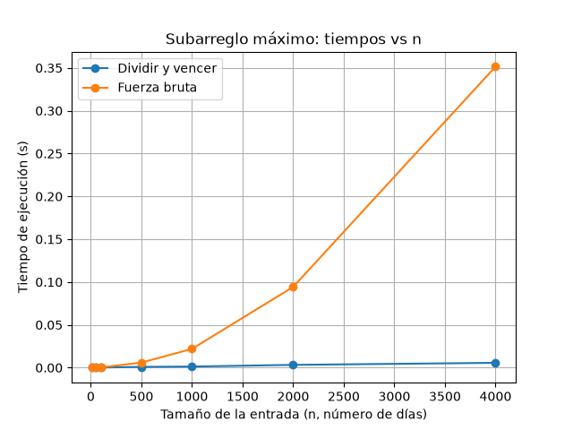

# Laboratorio 2 — Dividir y vencer

**Autor:** SANTIAGO VILLADA ARBOLEDA

## Cómo reproducir el experimento

Desde la raíz del repositorio activo el entorno virtual (con `matplotlib` instalado, ver `requirements.txt`) y entro a la carpeta del laboratorio:

```bash
# Windows
.venv\Scripts\activate
# Mac / Linux
source .venv/bin/activate

cd lab2-divide-y-vencer
python pruebas.py     # pruebas de las dos soluciones
python medicion.py    # medición de tiempos y gráfica
```

## Parte 1 — Implementar y verificar

Código: [`subarreglo.py`](subarreglo.py) y [`pruebas.py`](pruebas.py).

Implementé la fuerza bruta (Θ(n²), acumulando la suma en el ciclo), `suma_cruzada` y `subarreglo_maximo` por divide y vencerás, que resuelve los tres casos sin llamar a la fuerza bruta. Para verificar escribí `pruebas.py` con `assert`, y cada caso imprime su resultado. 

- la serie de ocho días de la cooperativa (suma 17)
- una serie de un solo elemento
- una serie con todos los valores negativos
- una serie con todos los valores positivos
- un caso donde el mejor tramo cruza el punto medio (se comprueba que la suma cruzada le gana a la de cada mitad)
- que las funciones no modifican la lista recibida
- 30 listas aleatorias (semilla fija) donde ambas funciones dan la misma suma.

## Parte 2 — Medir y graficar

Código: [`medicion.py`](medicion.py).



**Cómo medí:** usé la semilla 42, enteros entre -100 y 100, y la misma lista para ambos algoritmos en cada tamaño. Cronometré solo la llamada al algoritmo con `time.perf_counter()` y medí **una sola vez por tamaño**, así que hay algo de ruido del computador. En cada tamaño el programa verifica con `assert` que ambas sumas coinciden.

| n | Dividir y vencer (s) | Fuerza bruta (s) |
|---:|---:|---:|
| 10 | 0,000031 | 0,000004 |
| 50 | 0,000043 | 0,000071 |
| 100 | 0,000077 | 0,000127 |
| 500 | 0,000444 | 0,003982 |
| 1000 | 0,000937 | 0,016730 |
| 2000 | 0,001913 | 0,067421 |
| 4000 | 0,004008 | 0,279497 |

## Parte 3 — Análisis

### 1. Recurrencia
 
Mi algoritmo `subarreglo_maximo` divide la lista en dos partes, por lo que resuelve dos subproblemas de tamaño aproximado n/2. Después compara el mejor resultado de la izquierda, el de la derecha y el que cruza el punto medio. Para este último, suma_cruzada recorre desde el medio hacia ambos lados, pasando una vez por todos los elementos, así que cuesta aproximadamente n operaciones.

La recurrencia queda así: T(n) = 2T(n/2) + n. Según el método maestro, a = 2 (dos subproblemas) y b = 2 (cada uno es la mitad). El trabajo adicional crece al mismo ritmo que n^log₂2 = n, así que se cumple la condición del caso 2 y el resultado es Θ(n log n).

La fuerza bruta es Θ(n²) porque prueba las combinaciones posibles de inicio y final del subarreglo. Aunque suma de forma acumulativa, hay cerca de nxn/2 combinaciones, y eso crece con el cuadrado del tamaño de la lista.
 
### 2. Lo medido contra lo esperado
 
En la gráfica, la fuerza bruta se dispara hacia arriba, cada vez más empinada: con 4000 datos está en unos 0,28 s. La de dividir y vencer sube muy suave, casi pegada abajo: con 4000 marca unos 0,004 s, casi nada, unas 70 veces menos.
 
Tomé el paso de 2.000 a 4.000 elementos, donde el tamaño de la entrada se duplica. La fuerza bruta pasó de 0,067 s a 0,279 s, multiplicándose aproximadamente por 4,15, mientras que dividir y vencerás pasó de 0,0019 s a 0,0040 s, con un crecimiento cercano al doble (aproximadamente 2,10 según la medición). Esto se acerca a lo esperado: con una complejidad de Θ(n²), el tiempo puede multiplicarse por 4 al duplicar la entrada, mientras que con Θ(n log n) crece un poco más del doble, alrededor de 2,2 veces. Entonces, los resultados sí van de acuerdo con la teoría. Las pequeñas diferencias son normales, ya que hice una sola medición por tamaño y el computador también puede influir un poco en los tiempos.
 
### 3. Tamaños pequeños
 
En mis pruebas, con 10 elementos ganó la fuerza bruta (0,000004 s frente a 0,000031 s de dividir y vencerás). Pero cuando pasé a 50 elementos, dividir y vencerás empezó a ser más rápido (0,000043 s frente a 0,000071 s), y desde ahí la diferencia fue aumentando. Esto pasa porque, con listas pequeñas, las llamadas recursivas tienen un costo adicional que hace que dividir y vencerás se demore un poquito más. Pero, cuando aumenta la cantidad de datos, ese costo deja de ser tan importante y se nota la ventaja de revisar menos combinaciones.
 
### 4. ¿Cuándo conviene dividir?
 
Si el problema fuera encontrar el número más grande de una lista, recorrerla una sola vez sería suficiente: se compara cada número con el mayor encontrado hasta ese momento, lo que toma un tiempo proporcional a n.

Si se divide la lista en dos, se buscan los máximos de cada mitad y luego se comparan. Combinar cuesta una sola comparación, así que la recurrencia sería T(n) = 2T(n/2) + 1. Con el método maestro, ese trabajo es mucho menor que n, por lo que cae en el caso 1 y da Θ(n), igual que recorrerla una vez. Dividir no mejora nada y agrega llamadas recursivas, así que es más sencillo recorrer la lista.
 
### 5. Concepto para la gerente
 
Para la cooperativa le recomendaría a la gerente usar `subarreglo_maximo` (dividir y vencerás), porque es mucho más eficiente cuando se trabaja con grandes cantidades de registros. Con unos 2.000 o 4.000 datos, ambos algoritmos pueden funcionar, pero cuando se llega a cientos de miles o millones de registros, la fuerza bruta puede tardar demasiado.

**Esta seria la estimación.** Para calcularla, tomé como referencia los resultados con 4.000 elementos y los proyecté a 1.000.000. Esto significa que la cantidad de datos aumenta 250 veces (1.000.000 / 4.000 = 250), pero el tiempo no aumenta igual para los dos algoritmos.

- **Fuerza bruta:** como su tiempo crece aproximadamente con \(n^2\), el aumento sería de 250 × 250 = 62.500 veces. Entonces, 0,28 segundos × 62.500 da unos 17.500 segundos, es decir, cerca de **4,9 horas**.
- **Dividir y vencerás:** crece con n log n, o sea un poquito más que los datos por el logaritmo, que pasa de más o menos 12 a más o menos 20 (un factor de 1,67). Entonces aumenta unas 250 × 1,67 ≈ 417 veces, y 0,004 s × 417 da aproximadamente **1,7 segundos**.

Los tiempos reales pueden variar según el computador y las condiciones de ejecución, pero la diferencia estimada es bastante clara: **horas frente a unos pocos segundos**. Por eso, dividir y vencerás sería la mejor opción para trabajar con grandes volúmenes de información.