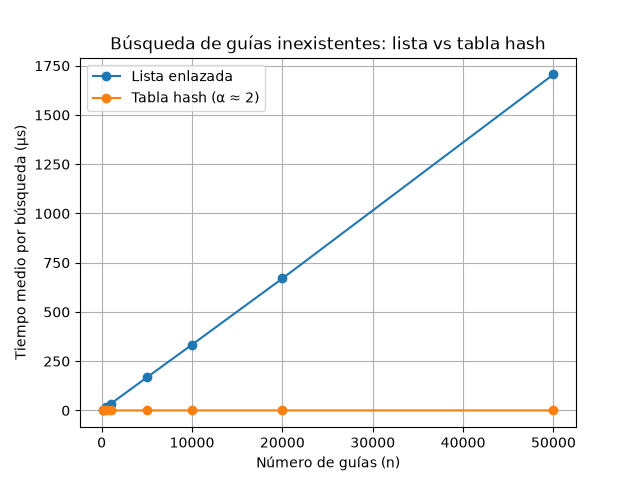
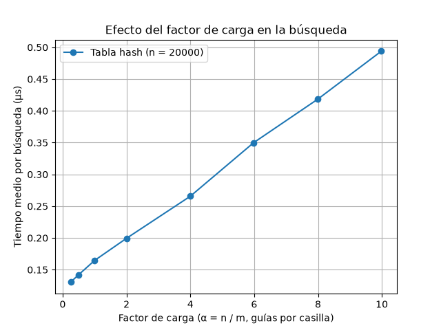

# Laboratorio 3. Estructuras de datos

**Autor:** SANTIAGO VILLADA ARBOLEDA

## Cómo reproducir el experimento

Desde la raíz del repositorio activo el entorno virtual (con `matplotlib` instalado, ver `requirements.txt`) y entro a la carpeta del laboratorio:

```bash
# Windows
.venv\Scripts\activate
# Mac / Linux
source .venv/bin/activate

cd laboratorios/lab3-estructuras-datos
python pruebas.py     # pruebas de la lista y la tabla hash
python medicion.py    # medición de tiempos y las dos gráficas
```

## Parte 1. Implementar y verificar

Código: [`estructuras.py`](estructuras.py) y [`pruebas.py`](pruebas.py).

Implementé la `ListaEnlazada`, que inserta al inicio (O(1)) y busca recorriendo con un `while` desde la cabeza, y la `TablaHash` con encadenamiento, donde cada casilla es una `ListaEnlazada` y la función hash es por división, h(k) = k mod m. No usé `dict`, `set` ni el `hash()` de Python. Para verificar escribí `pruebas.py` con `assert`, y en los casos 1, 3 y 4 imprimo el resultado para verlo en la consola:

- las dos estructuras vacías, donde buscar da `None` y el factor de carga da 0
- la colisión forzada con m = 7: las guías 10, 24 y 17 caen las tres en la casilla 3; se pueden buscar después, la lista de esa casilla tiene longitud 3, las otras casillas quedan vacías y `factor_carga()` da 3/7
- 20 colecciones aleatorias (semilla 42), con n y m al azar, donde la lista y la tabla devuelven lo mismo tanto para guías que existen como para guías que no existen.

## Parte 2. Medir y graficar

Código: [`medicion.py`](medicion.py).





Las guías son enteros distintos de diez dígitos generados con semilla 42, y en cada n uso las mismas guías para la lista y para la tabla. Las guías inexistentes salen de `generar_guias_inexistentes` (semilla 7). En cada medición hago 200 búsquedas de guías que no existen y cronometro solo las búsquedas con `time.perf_counter()`, no la construcción de las estructuras ni la generación de los datos. Como una búsqueda en la tabla dura menos de medio microsegundo y el ruido del computador pesa mucho, **repito las 200 búsquedas 30 veces y uso el promedio**. Antes de medir, el programa verifica con `assert` que, para una muestra de 100 guías existentes, la lista y la tabla devuelven el mismo estado, y que las inexistentes dan `None`.

En el experimento A, la tabla usa m primo cercano a n/2, para que α quede alrededor de 2. En el experimento B dejé n = 20.000 fijo y fui cambiando m (siempre primo) para que α tomara 8 valores entre 0,25 y 10. Como m es primo, el α no queda exacto, por eso en la gráfica uso el α real que da `factor_carga()`.

Estas tablas y las gráficas de arriba salen de **la misma corrida** de `medicion.py`:

**Experimento A. Lista frente a tabla**

| n | m | α | Lista (µs) | Tabla (µs) |
|---:|---:|---:|---:|---:|
| 100 | 53 | 1,89 | 3,514 | 0,186 |
| 500 | 251 | 1,99 | 16,645 | 0,189 |
| 1.000 | 503 | 1,99 | 33,691 | 0,190 |
| 5.000 | 2.503 | 2,00 | 167,470 | 0,207 |
| 10.000 | 5.003 | 2,00 | 333,962 | 0,197 |
| 20.000 | 10.007 | 2,00 | 669,875 | 0,216 |
| 50.000 | 25.013 | 2,00 | 1.706,044 | 0,208 |

**Experimento B. Efecto del factor de carga (n = 20.000)**

| m | α | Tabla (µs) |
|---:|---:|---:|
| 80.021 | 0,25 | 0,130 |
| 40.009 | 0,50 | 0,142 |
| 20.011 | 1,00 | 0,165 |
| 10.007 | 2,00 | 0,199 |
| 5.003 | 4,00 | 0,266 |
| 3.343 | 5,98 | 0,350 |
| 2.503 | 7,99 | 0,418 |
| 2.003 | 9,99 | 0,494 |

## Parte 3. Análisis

### 1. Costo teórico

**Lista enlazada.** Cuando busco una guía que no existe, el `while` de `buscar` arranca en la cabeza y compara nodo por nodo. No hay forma de saber que la guía no está sin compararla contra todas: el ciclo solo se detiene al llegar a `None`, o sea, después de los n nodos. Siempre son exactamente n comparaciones, por eso es O(n).

**Tabla hash con encadenamiento.** Primero calcula h(k) = k mod m y entra a esa casilla; eso no depende de cuántas guías haya, es el "1". Después recorre solo la lista de esa casilla. Si las n guías quedan repartidas parejo, cada lista tiene en promedio n/m = α guías, entonces el costo promedio es O(1 + α).

**El supuesto.** Eso se sostiene en el *hashing uniforme simple*: cada guía tiene la misma probabilidad de caer en cualquiera de las m casillas, independiente de las demás.

**Si todas cayeran en la misma casilla**, la tabla se vuelve una lista enlazada disfrazada y buscar una guía inexistente vuelve a ser O(n).

### 2. Lo medido contra lo esperado

**Primera gráfica.** La lista sube como una línea recta y la tabla se ve pegada al piso. Tomé el paso de n = 10.000 a 20.000, donde n se duplica:

- **Lista:** pasó de 333,962 a 669,875 µs, se multiplicó por ≈ **2,01**. Con O(n), si n se duplica el tiempo también, así que coincide.
- **Tabla:** pasó de 0,197 a 0,216 µs, se multiplicó por ≈ **1,10**. Con O(1) (α fijo en 2) debería ser 1, y da muy cerca; la diferencia es ruido, porque de 5.000 a 10.000 más bien bajó.

**Segunda gráfica.** Con n = 20.000, cuando α crece el tiempo sube casi en línea recta: de 0,130 µs con α = 0,25 a 0,494 µs con α ≈ 10. Un ajuste lineal a los 8 puntos da tiempo ≈ 0,124 + 0,037 · α (µs), que tiene justo la forma de 1 + α: un pedazo fijo, que es el "1", y 0,037 µs por cada guía de más en la casilla, que es el "α".

### 3. Explique las colisiones

Una colisión es cuando dos guías distintas dan el mismo hash. Con m = 7, las guías 10, 24 y 17 dan residuo 3, así que las tres caen en la casilla 3.

Las colisiones pasan incluso si la tabla tiene más casillas que guías, porque las guías posibles de diez dígitos son muchísimas más que las casillas, entonces a la fuerza muchas comparten casilla. Además, aunque se repartan al azar, que dos caigan juntas es muy probable, como en la paradoja del cumpleaños.

**Encadenamiento.** Cada casilla guarda una lista enlazada. Como inserto al inicio, la casilla 3 queda `17 → 24 → 10 → None`.

- **Ventaja:** la tabla nunca se llena: α puede pasar de 1 y el rendimiento se daña poquito a poco, como en mi segunda gráfica.
- **Costo:** memoria extra por cada nodo y su apuntador `siguiente`.

**Direccionamiento abierto.** Todo va en el mismo arreglo y, si la casilla está ocupada, se prueba otra. Con sondeo lineal: 10 queda en la 3, 24 encuentra la 3 ocupada y queda en la 4, y 17 queda en la 5.

- **Ventaja:** no gasta memoria en apuntadores.
- **Costo:** α nunca puede pasar de 1 y, cuando se acerca, los intentos se disparan; además se forman bloques ocupados y borrar es más complicado.

### 4. Tabla hash o árbol de búsqueda

**La tabla hash no sirve para rangos.** k mod m no guarda el orden de las guías, ni entre casillas ni dentro de cada una. Para "guías entre X y Y" tocaría recorrer toda la tabla, O(n + m), o buscar uno por uno cada número entre X y Y, que pueden ser millones que ni existen.

**El ABB.** Todo lo de la izquierda de un nodo es menor y lo de la derecha mayor. Para el rango se baja desde la raíz descartando ramas completas y se sacan las guías ordenadas con un recorrido en inorden, en O(h + k), con h la altura y k las guías de la respuesta.

**Si las 400.000 guías llegan ordenadas**, cada una nueva es mayor que las anteriores y siempre se va a la derecha: el árbol queda como una lista. Altura: n − 1 = **399.999**; buscar una guía inexistente mayor que todas: unas **400.000 comparaciones**.

**Árbol equilibrado** (AVL o rojinegro): altura ≈ log₂ 400.000 ≈ **19**, o sea unas 20 comparaciones, unas 20.000 veces menos.

### 5. Concepto para la jefa de operaciones

**Recomendación:** usar las dos al tiempo. Una **tabla hash** para el call center, con m creciendo junto con los envíos para que α siga cerca de 2, y un **árbol equilibrado** con las mismas guías para los rangos (no un ABB normal, por lo de la pregunta 4). El costo es guardar cada guía dos veces.

**Estimación con 5.000.000 de envíos.** Esto es una **estimación**, no una medición, partiendo de n = 50.000 (5.000.000 es 100 veces más).

- **Lista:** en mi primera gráfica es una recta que pasa casi por el origen (al duplicar n el tiempo se duplicó), así que crece proporcional a n: 1.706 µs × 100 ≈ **0,17 s** por búsqueda fallida.
- **Tabla:** aquí no se multiplica por 100, porque el tiempo depende de α y no de n: con α ≈ 2 se quedó entre 0,19 y 0,22 µs aunque n creció 500 veces. Con m ≈ 2.500.000 quedaría en unos **0,2 µs**.
